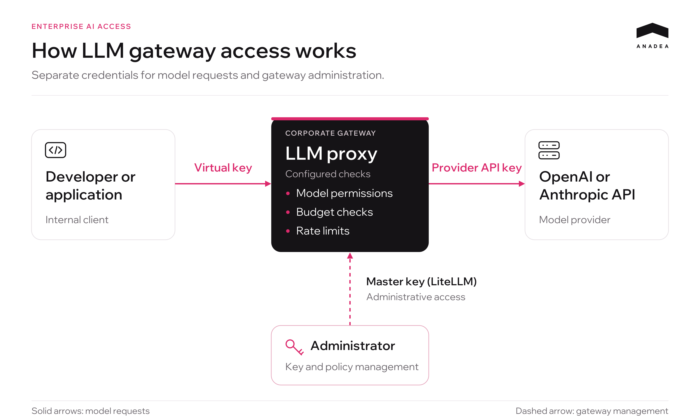
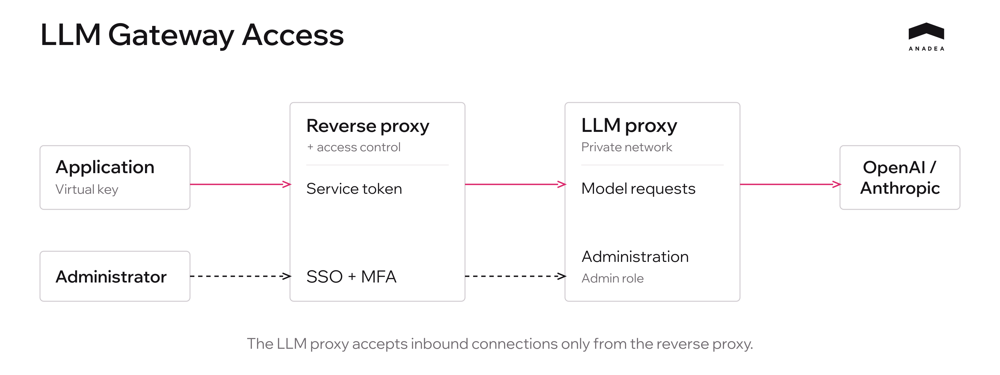

Centralizing AI access is a natural step for any growing tech team. To manage costs, engineering leaders usually set up an LLM proxy (like LiteLLM or Portkey) to hand out virtual API keys for OpenAI or Anthropic. But in the rush to get these services up and running, basic network security hygiene is easy to overlook. A single exposed port, combined with outdated proxy software, can turn internal infrastructure into an easy target for automated scanners. Once attackers gain administrative access, they can generate their own API keys and burn through the company’s monthly AI budget on the most expensive models in just 15 minutes.

This article goes beyond documentation and theory to examine real-world attacks on LLM proxies and provide a step-by-step engineering guide to implementing defense in depth. We’ll show you how to isolate your gateway, restrict access, and automate vulnerability checks with practical steps to contain a breach and limit unauthorized spending.

## How an LLM Gateway Controls Access to Models

Before looking at how attackers can drain an AI budget, it helps to understand why companies deploy an LLM proxy.

Providers such as OpenAI and Anthropic offer limited out-of-the-box control over individual developers’ spending. If an engineer receives a direct API key for a shared company account, their usage draws from that account’s budget. A faulty script or a series of expensive requests can burn through a monthly budget of several hundred dollars in minutes.

To manage this, teams deploy an LLM proxy. This server receives requests from internal applications and developers, then forwards them to the provider.

Three types of keys play a role in this setup:

1. Provider API keys. Keys issued by OpenAI or Anthropic and stored within the gateway. They authorize API requests billed to the company’s provider account.
2. Virtual keys. Keys issued by the gateway to individual developers or projects. Each should be configured with access to approved models and daily or monthly spending limits.
3. Administrative master key. The gateway’s main management credential. It allows configuration changes through the API, including adding model endpoints and creating virtual keys.

When reviewing a key, check its actual permissions: which models it can call, which limits apply, and whether it can create other keys or change access rules. For model requests, LiteLLM recommends using[ keys with the minimum required permissions](https://docs.litellm.ai/docs/proxy/security_best_practices#3-use-least-privilege-access). Administrative access should be secured separately.

## How an Attack on an Enterprise LLM Gateway Unfolds

Attackers can use automated scanning to find exposed LLM proxies without targeting a specific company. An unpatched vulnerability may then allow them to gain administrative access.

### 1. Network Exposure and Outdated Software

A proxy port can be left accessible from the internet during deployment. For example, Docker publishes ports on all host addresses by default unless a bind address is specified. Without network restrictions, this can expose the service publicly, as described in the[ Docker documentation](https://docs.docker.com/engine/network/port-publishing/).

The following checks can be automated:

1. Port scanning (a scanner checks which server ports are reachable from outside the network).
2. Service identification (HTTP responses and available routes help identify the service as an LLM proxy).
3. Vulnerability checks (the attacker looks for known vulnerabilities and available exploits for the installed version, then checks whether they apply to the deployment).

### 2. Taking Control Through the API

Administrative APIs support key creation and configuration changes. Securing only the login page overlooks this separate way to manage the gateway.

A stolen administrative key or a flaw in authorization checks can grant access to these operations. For example,[ GHSA-4xpc-pv4p-pm3w](https://github.com/BerriAI/litellm/security/advisories/GHSA-4xpc-pv4p-pm3w) describes a Host header parsing flaw in LiteLLM that, under specific conditions, allowed unauthenticated access to protected management routes.

If the attacker gains permission to create and configure keys, they can proceed as follows:

1. They do not need to steal employees’ existing virtual keys.
2. They call the management API to create their own virtual keys.
3. They give the new keys access to expensive models and set their budgets, within the permissions they have gained.

An existing key’s individual spending cap will not stop these requests. Shared budgets and rate limits may still apply, provided they are configured to cover the new keys.

### 3. Running Up Costs and Stopping the Attack

The attacker uses the new keys to send requests through the proxy. The gateway calls the provider using the company’s credentials, and the company pays for the usage.

Costs depend on the models used, input and output token counts, and request rate. Parallel requests allow the attacker to increase usage within the available quotas and limits.

To stop new requests, the team isolates the proxy and revokes the compromised access. Any keys created by the attacker must also be identified and blocked. If the attacker also obtained provider keys, the team must revoke them with the provider. Those keys can be used for direct requests that bypass the gateway.

### 4. Investigation Gaps (Metadata and Request Content)

After stopping the attack, the team needs to identify the keys and models used, the costs incurred, and any administrative changes.

Request metadata can show timestamps, model names, key identifiers, token usage, and costs. Reconstructing the sequence of events also requires records of key creation, permission changes, and configuration updates.[ OWASP’s logging guidance](https://cheatsheetseries.owasp.org/cheatsheets/Logging_Cheat_Sheet.html) explains how to record administrative actions and event context.

Request and response bodies let investigators examine the content of individual calls. Check in advance whether your system stores them: enabling this logging after an incident will not recover earlier messages.

Investigating a possible data leak also requires reviewing access to files, storage systems, and other resources that may have been affected.

## Blocking the Attack Path: A New Access Architecture

In the attack described above, the attacker gained access to administrative operations through the API. Blocking this path requires network restrictions around the proxy and a clear separation between model access and gateway administration.

### 1. Remove Direct Access to the LLM Proxy

Place a reverse proxy in front of the LLM proxy and enforce access controls—for example, through an SSO gateway. Configure the LLM proxy to accept inbound connections only from that entry point.

If both services run on the same host, bind the internal port to loopback or keep it within an isolated container network. If they run on separate hosts, restrict connections using firewall rules or security groups.

**Adding a reverse proxy does not automatically block direct access to the service.** Check that the internal port cannot be reached from the internet using the server’s public IP address. Otherwise, an attacker could bypass the checks at the entry point.

Private networking, exposing only the necessary routes, and using TLS are also covered in the[ gateway deployment security recommendations](https://docs.litellm.ai/docs/proxy/security_best_practices#5-restrict-network-access).

### 2. Separate Employee and Application Access

For the management dashboard, configure SSO through the corporate identity provider and require MFA. Grant administrative access to a designated user group. Signing in with a corporate account should not automatically give someone administrator privileges.

Applications need authentication that works without a browser, such as a service token or mTLS at the entry point. For example,[ service tokens in Cloudflare Access](https://developers.cloudflare.com/cloudflare-one/access-controls/service-credentials/service-tokens/) allow automated systems to connect to a protected service.

Once a request passes this check, the LLM proxy must still validate the virtual key, permitted models, budget, and allowed operations. Access at the entry point and permissions within the LLM proxy are checked separately.

### 3. Restrict Key Permissions at the API Level

For model requests, explicitly allow only the routes and HTTP methods the client needs. If an application only requires **POST /v1/chat/completions**, it does not need permission to create keys, change budgets, or configure models. Add other routes as needed.

Enforce these restrictions both at the reverse proxy and within the LLM gateway’s authorization logic. Hiding a button in the dashboard offers no protection if the same operation is still available through a direct API request.[ OWASP recommends](https://cheatsheetseries.owasp.org/cheatsheets/Authorization_Cheat_Sheet.html) denying access by default and checking permissions on every request.

For this setup, permissions could be divided as follows:

<table>

<thead>

<tr>

<th>

<strong>Who</strong>

</th>

<th>

<strong>Access method</strong>

</th>

<th>

<strong>Allowed operations</strong>

</th>

</tr>

</thead>

<tbody>

<tr>

<td>

Developer

</td>

<td>

Personal virtual key through the protected entry point

</td>

<td>

Call approved models within configured limits

</td>

</tr>

<tr>

<td>

Application

</td>

<td>

Service authentication at the entry point and a separate virtual key

</td>

<td>

Use the API routes and models required by the application

</td>

</tr>

<tr>

<td>

Administrator

</td>

<td>

SSO, MFA, and an assigned administrative role

</td>

<td>

Manage keys, models, and budgets within the role&rsquo;s permissions

</td>

</tr>

</tbody>

</table>

A “virtual key” is not necessarily a restricted key. In LiteLLM, for example, access to management routes can depend on the key owner’s role. The[ documentation on inherited permissions](https://docs.litellm.ai/docs/proxy/virtual_keys#what-a-key-inherits-from-its-owner) explains this behavior. During an audit, check what each key can actually do.

Store the master key in a secret store with restricted access. Do not use it for routine model requests or include it in client application configurations. Provider keys should also remain on the gateway side.

### 4. Verify the Restrictions with Direct Requests

After configuration, test at least these four scenarios:

1. Connect to the internal port from the internet: the connection is blocked.
2. Call an approved model with a key issued for model requests: the request succeeds.
3. Try to create a key or change a budget with that same key: the operation is denied.
4. Try to access administrative functions with a regular corporate account: access is denied.

Test the LLM proxy’s own authorization checks separately from a trusted network. This confirms that key restrictions remain in effect even after a request has passed through the external gateway.

## Layered Financial Protection

Even with network isolation and restricted permissions, an individual key can still be compromised. To prevent a leaked key from running up large bills, spending controls are split across three independent layers.

1. **Virtual keys and the LLM gateway.** Each key gets its own budget. Once that budget is exhausted, the gateway rejects new billable requests. An overall gateway budget also caps total spending across all keys, including newly created ones.
   For concurrent traffic, budget checks must also account for requests still in progress. Cost reservation and handling failures in spend tracking are covered in the[ budget documentation](https://docs.litellm.ai/docs/proxy/users).
2. **Provider accounts.** These limits also apply to requests that bypass your gateway. OpenAI supports[ hard monthly spending limits for organizations and projects](https://developers.openai.com/api/docs/guides/spend-limits), while Anthropic provides[ monthly workspace budgets](https://platform.claude.com/docs/en/manage-claude/workspaces).
   In OpenAI, enable *Enforce a hard limit*: a standard alert does not block requests. Enforcement is not instantaneous, so actual spending may slightly exceed the configured amount.
3. **Payment card.** Set hard spending limits on the card linked to the provider accounts: a maximum of $100 per day and $2,000 per month. Once those limits are reached, the bank will decline further transactions, even if controls within the proxy and provider platform have been bypassed.

Many teams rely on monitoring scripts, or watchdogs, for protection. It is important to distinguish three separate functions:

* **Accounting:** Records token usage and current spending in logs or a database.
* **Alerting:** Sends a Slack notification or email when spending reaches a specified percentage of the budget.
* **Enforcement (hard cutoff):** Automatically rejects incoming API requests at the gateway without waiting for an administrator to act.

A watchdog that only collects usage data and sends alerts helps detect a problem. Stopping further spending without waiting for an engineer requires automatic blocking at the gateway or provider.

Financial protection should not depend on a single tool. Spending controls at the virtual key, provider account, and payment card levels create three layers of protection that help limit potential losses.

## Logging and Observability

Investigating an incident requires request metadata and an audit trail of administrative actions. For each API request, log:

* Timestamp, request_id, provider, and model.
* Identifiers for the key, user, service, or project.
* Input and output token counts and cost.
* Request status, duration, and any error or rejection reason.

The audit trail records key creation and revocation, changes to roles, model access, and budgets—with the actor, timestamp, and outcome for each action. Never log bearer tokens, the master key, or provider API keys. The[ OWASP Logging Cheat Sheet](https://cheatsheetseries.owasp.org/cheatsheets/Logging_Cheat_Sheet.html) provides guidance on which events to capture and how to protect logs.

Logging **input** and **output** content helps establish what the model processed. Configure this separately—for example, through **store_prompts_in_spend_logs** in LiteLLM. The setting only affects new log entries; it does not recover earlier messages.

Requests may contain personal data, source code, and confidential documents. Where the GDPR applies, establish a purpose and legal basis for processing and inform the individuals concerned. Limit the data collected and define a retention period appropriate to that purpose.

Store logs centrally, protect them from unauthorized modification and deletion, and grant access on a need-to-know basis. Remove or mask secrets and unnecessary personal data before writing them to logs.

Configure alerts for bulk key creation, sudden spending spikes, repeated access denials, and interruptions in log collection.

## CVE Monitoring with an AI Agent and Slack

At Anadea, we set up an AI agent to automate checks for new releases and security advisories affecting our LLM gateway.

A script collects the installed version, deployment settings, and new security advisories. The agent analyzes this information and prepares a short report in Slack:

* Whether the installed version is still supported.
* Which CVEs may affect our version and configuration.
* Which release contains the fix and whether we need to update ahead of schedule.

The report arrives every Monday. Separate alerts flag critical findings relevant to our deployment. Each message includes sources and an explanation, which an engineer reviews to verify the findings and decide what to do next.



## LLM Gateway Security Audit Checklist

An audit checks what each type of key can do and how the system behaves when a budget is exhausted or spend tracking fails. Run these checks before launch and repeat them after configuration changes.

1. The LLM proxy’s internal port cannot be reached from the internet, including through the server’s public IP address.
2. Keys used for model requests cannot create other keys or modify budgets or configuration.
3. Administrative access requires SSO and MFA. The master key and provider API keys are kept out of client applications.
4. Spending limits at the key, gateway, and provider levels have been tested, including under concurrent traffic.
5. The gateway rejects billable requests when the remaining budget cannot be verified.
6. Logs link requests, spending, and administrative changes to specific keys and users. They are protected against unauthorized deletion.
7. The gateway runs a supported version, CVE advisories are reviewed, and a named engineer is responsible for urgent updates.
8. Designated responders can quickly isolate the gateway and revoke keys, including provider API keys.

## Conclusion

The goal of securing an LLM gateway is to ensure that no single misconfiguration or outdated component can lead to uncontrolled spending.

Reliable infrastructure requires a layered approach. At the network level, the gateway is isolated behind a reverse proxy and SSO, with direct access to its internal ports blocked from the public internet. At the API level, all external requests to change the configuration or generate new keys are rejected at the entry point. Permissions are controlled through virtual keys scoped to specific models, with hard daily spending limits. Additional limits at the provider and payment card levels provide a final safeguard.

This approach guarantees that losses from any compromise stay within the daily limit of the affected key, while anomalous activity is stopped automatically without human intervention.
