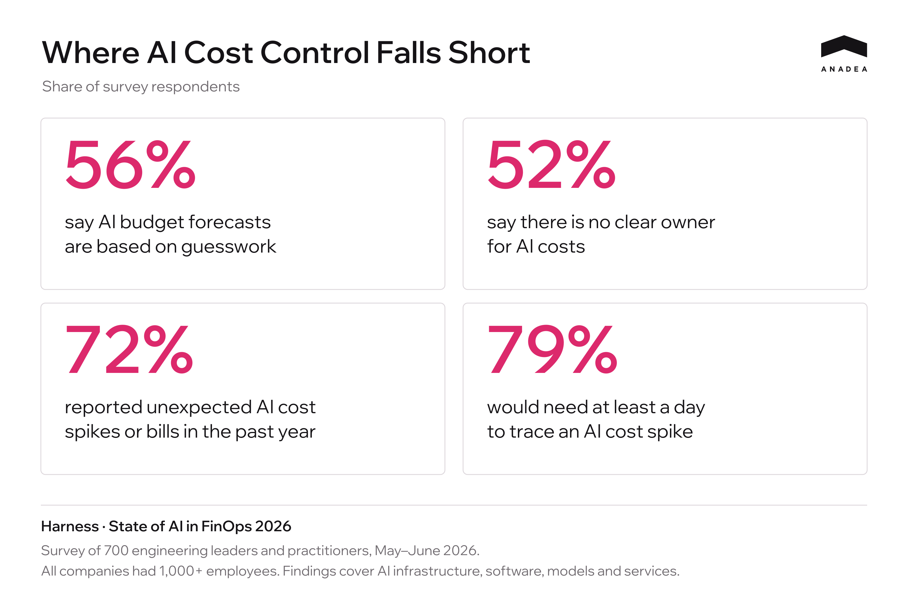
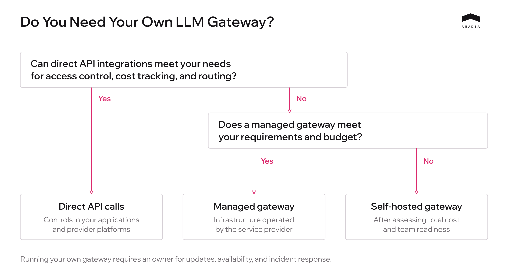

In our [previous article on LLM gateway security](https://anadea.info/blog/secure-enterprise-llm-api-keys), we covered how to isolate infrastructure, restrict administrative access, and protect API keys. But even without an attack, teams can spend more than they need to on everyday API calls.

As more services and projects start using OpenAI and Anthropic, the provider’s monthly bill no longer gives you enough detail to manage spending:

* The API bill keeps growing, but the team isn’t tracking what it costs to process a single document or user request.
* Several projects share one key. At the end of the month, it’s hard to work out how much each project spent and on what.
* Simple text classification runs on the same expensive model as complex analysis. No one has checked whether a cheaper model could handle it.

We’ll look at how to manage access to OpenAI and Anthropic through an enterprise LLM gateway: track spending by team and project, route requests to models that meet the task’s quality requirements, and set budgets based on actual usage. We’ll also examine when running your own gateway is worth the cost of maintaining it.

## Why AI Spending Is Hard to Control

LLM API costs can rise even when user numbers stay the same. Switching to a more expensive model, sending more context, or retrying requests more often can all increase the bill. Teams make these decisions during development but may only see their financial impact when the invoice arrives.

The[ 2026 Harness study](https://www.harness.io/state-of-ai-in-finops-2026) surveyed 700 engineering leaders and practitioners at companies with at least 1,000 employees. It examined spending across AI infrastructure, software, models, and services.

The FinOps Foundation reports similar difficulties in its[ State of FinOps 2026](https://data.finops.org/) study. Respondents struggle to allocate AI costs across departments and assess what their organizations gain from that spending.

For teams using LLM APIs, a total by provider doesn’t provide enough detail. They need to see what each project spends, which models it uses, and how usage changes after updates. Someone on the team also needs to be responsible for reviewing increases and deciding whether they are justified.

A centralized LLM gateway helps organize this tracking. Assigning virtual keys to specific teams and projects makes it possible to track their usage separately and manage which models they can access.

## Centralized Access Through an LLM Gateway

An LLM gateway receives requests from developers and applications, checks their permissions, and forwards the requests to the provider. Clients use the gateway’s virtual keys. OpenAI and Anthropic API keys are stored in a secrets manager that the gateway can access. When those provider keys change, client applications keep using their existing virtual keys.

When setting up access, follow these steps.

* Give each developer a personal key linked to their user account.
* Give applications service keys that are independent of individual employee accounts. LiteLLM provides[ service accounts](https://docs.litellm.ai/docs/proxy/service_accounts) whose keys remain in place when a user account is deleted.
* Associate service keys with their teams and projects, and record the environment. Issue separate keys for production and test environments.
* Define which models each key can access. The gateway should reject requests to models outside that list.

A key can be associated with a user, a team, or both. This supports separate spend tracking by key, user, and team. Multiple keys belonging to one team can draw from a shared budget while retaining individual usage records.

The gateway calculates request costs from usage data and configured pricing. Reconcile these figures with provider charges regularly, especially after pricing changes or the addition of new models.

Revoke old keys used for direct integrations once those integrations have moved to the gateway. Where needed, use network rules to allow outbound access to provider APIs only from the gateway. If some services continue to call providers directly, track their costs separately and include them in the overall spending report.

## Reducing Costs Through Model Selection and Routing

Model choice directly affects the cost of an AI feature. When several models meet your quality requirements, compare what it costs each one to complete the task. For high-volume operations, even a small difference in cost per call adds up.

Matching models to task types helps identify where a company can reduce spending and where a more capable model justifies its price.

<table>

<thead>

<tr>

<th>

<strong>Task category</strong>

</th>

<th>

<strong>Example models</strong>

</th>

<th>

<strong>Input, USD per 1M tokens</strong>

</th>

<th>

<strong>Output, USD per 1M tokens</strong>

</th>

<th>

<strong>Typical use cases</strong>

</th>

</tr>

</thead>

<tbody>

<tr>

<td>

High-volume tasks with a defined output format

</td>

<td>

GPT-6 Luna, Claude Haiku 5.5

</td>

<td>

0.10

</td>

<td>

0.50

</td>

<td>

Text classification, field extraction, structured JSON output

</td>

</tr>

<tr>

<td>

Text and code tasks

</td>

<td>

GPT-6.1 Sol, Claude Sonnet 5.5

</td>

<td>

2.00

</td>

<td>

10.00

</td>

<td>

Document summarization, answers grounded in retrieved data, code generation and editing

</td>

</tr>

<tr>

<td>

Complex analysis and multistep tasks

</td>

<td>

GPT-6 Astra, Claude Fable 5.1

</td>

<td>

10.00

</td>

<td>

50.00

</td>

<td>

Architectural analysis, complex refactoring, tasks with several dependent steps

</td>

</tr>

</tbody>

</table>

These are the standard rates published by[ OpenAI](https://developers.openai.com/api/docs/pricing) and[ Anthropic](https://platform.claude.com/docs/en/about-claude/pricing), checked in October 2026. Prices apply to requests with up to 100,000 input tokens, excluding caching, Batch discounts, and additional tool charges. The categories provide a starting point for testing models on your own workloads.

For the same token volume, the most expensive models in the table cost 100 times as much as the cheapest. Whether switching makes sense depends on the feature’s requirements. A cheaper model may handle one type of request reliably but need repeated attempts on another.

In the gateway, you can assign a tested model to a task-specific name, or alias. The application uses that name, while the team manages the underlying model in the gateway configuration. This makes it easier to update models centrally and control their use. Each replacement still needs compatibility checks and an evaluation of output quality.

Automatic routing becomes useful when requests within the same feature vary substantially. Rules or a classifier select the model for each request. Where outputs can be reliably validated, some tasks can go to a cheaper model first, with unsuccessful attempts retried using a more capable one. Limit these escalations so that repeated calls do not consume the savings.

Measure the result by the total cost per successfully completed task, including routing and retries. A model change should lower that cost while maintaining the agreed standards for quality and response time.

## Budgeting for Real Workloads With Hard and Soft Limits

A project budget starts with two figures — the expected number of tasks and the measured cost of completing them. That cost should include every model call, including retries. If the product handles several types of tasks, estimate the spending for each separately, then add them together.

Add a reserve for fluctuations in usage. Its size depends on how predictable traffic is, which features the team plans to launch, and how often models and prompts change. For a new project with no usage history, start with a pilot budget to gather the measurements needed for further planning.

In the gateway, assign budgets to projects and environments, then set an overall team limit that covers spending across all associated keys. This approach is described in[ LiteLLM’s team budget documentation](https://docs.litellm.ai/docs/proxy/team_budgets). Allocate separate amounts to production and experiments so that testing does not consume the funds needed to keep the product running.

Next, decide when the system should notify the budget owner and when it should stop accepting requests. **Soft and hard limits can work together.**[ LiteLLM’s documentation](https://docs.litellm.ai/docs/proxy/ui_team_soft_budget_alerts) distinguishes between a notification threshold and a budget limit that blocks requests.

<table>

<thead>

<tr>

<th>

<strong>Setting</strong>

</th>

<th>

<strong>What happens when the threshold is reached</strong>

</th>

<th>

<strong>What to decide in advance</strong>

</th>

</tr>

</thead>

<tbody>

<tr>

<td>

Soft Limit

</td>

<td>

The designated owner receives an alert. Requests continue to run

</td>

<td>

Who investigates the increase in spending and how much time they have to respond

</td>

</tr>

<tr>

<td>

Hard Limit

</td>

<td>

The gateway rejects new requests covered by the exhausted budget

</td>

<td>

How the application responds and who can approve a budget increase

</td>

</tr>

</tbody>

</table>

Set the alert threshold early enough to give the team time to act before requests are blocked. Track the rate of spending and the forecast for the rest of the budget period as well. If projected spending already exceeds the approved amount, investigate immediately, even if the soft limit has not yet been reached.

In production, an exhausted budget can make a feature unavailable to users. Define and test the application’s behavior in this situation before launch. Test budget enforcement under concurrent load too, since requests already accepted may add costs after the limit takes effect.

Review budgets after significant changes to traffic, models, or application logic. Assess task volume and cost per task separately. Greater product usage may justify a larger budget. A higher cost for the same work calls for an investigation. Any temporary limit increase should be approved by the budget owner and have a defined expiry date.

## When Running Your Own LLM Gateway Is Worth the Cost

Running your own LLM gateway adds infrastructure and engineering costs to your model spending. Whether it pays off depends on how much you save on API calls and access administration compared with what you spend operating it. There is no universal monthly API bill that makes self-hosting worthwhile.

If your providers already offer the access controls, budgets, and reporting you need, direct API integrations may be enough. When several teams need shared rules across multiple providers, consider a managed gateway. The service provider operates the infrastructure, while your team configures access, routing, and budgets.

Consider self-hosting when a managed service cannot meet your requirements for network isolation, log storage, internal integrations, or control over updates. It may also cost less at high request volumes, but that needs to be confirmed by comparing the full cost of each option.

Include the following costs when evaluating a self-hosted deployment.

* Compute a database, log storage, backups, and redundancy to meet your availability requirements.
* Engineering time for updates, compatibility checks with provider APIs, budget enforcement testing, and incident response.
* Licenses for any paid enterprise features and technical support.
* Initial setup, integration with internal systems, and application migration.

[LiteLLM’s production deployment documentation](https://docs.litellm.ai/docs/proxy/deploy) shows what the infrastructure involves. Key management and spend tracking require PostgreSQL, while coordinating multiple gateway instances requires Redis. These components also need monitoring, updates, and recovery procedures.

Compare the options over the same period, using the same workload forecast and requirements for quality and availability. For each option, calculate the combined cost of model usage and operations, including the initial migration. Include savings from routing or caching only after validating them against your own traffic.

The pilot should reveal both API spending and the engineering time needed for maintenance. Before connecting production applications, assign a service owner and establish an incident response process. Once access is centralized, every application using the gateway depends on its availability.



## Additional Cost Optimization Methods: Caching, Prompt Compression, and Open-Weight Models

Beyond centralized routing and budget limits, there are additional mechanisms for optimizing request processing costs. Their effectiveness should be evaluated solely on the total cost of completing the entire task, factoring in infrastructure overhead.

### Prompt and Response Caching

Repeated instructions, reference material, and conversation history can account for a substantial part of a prompt. Caching can reduce the cost of processing that content again.

* **Prompt caching** reuses context already processed by the provider. The model still generates a fresh answer, as[ OpenAI’s documentation](https://platform.openai.com/docs/guides/prompt-caching) explains. Check the model’s cache-write and read prices alongside your actual reuse rate. 
* **Response caching** returns an existing answer and avoids another model call altogether. Exact matching is the simpler option. Semantic matching can cover differently worded requests, but similar wording or meaning does not always justify the same answer. 

### Prompt Compression

Start by removing material the task does not need. Duplicate instructions, irrelevant retrieved passages, and unnecessary conversation history all add tokens. For longer prompts,[ Microsoft Research’s LLMLingua](https://github.com/microsoft/LLMLingua) can automate part of this work.

Test the compressed version against the original.

* Check for missing details and changes in output quality or format.
* Include the compressor’s own processing cost and any extra retries.
* Measure cache reuse again. Changing a shared prefix can reduce cache hits enough to cancel out the savings from a shorter prompt.

### Open-Weight Models

Once an open-weight model meets the application’s quality requirements and its license permits the intended use, compare two ways of running it.

* A **hosted API** charges for usage and leaves server operations to the provider. Compare its rates and performance with the APIs you already use.
* **Self-hosting** gives the team control over deployment and capacity, along with responsibility for keeping inference available.

For self-hosting, calculate costs over the expected workload. GPU rental or depreciation is only part of the bill. Spare capacity, maintenance, and engineering support also count, including during quiet periods when the hardware is underused. Sustained demand can improve the economics; the comparison still needs to meet the same quality and response-time requirements.

## Conclusion

A growing API bill needs context. As more people use your product’s AI features, higher spending may be justified. But if completing the same tasks is getting more expensive, the team needs to understand why and what can change without affecting quality.

An LLM gateway brings usage tracking and shared policies together across services. Teams can use that data to justify budgets, evaluate model changes, and verify that an optimization actually saves money.

The gateway’s operating costs belong in the calculation too. When choosing between direct API integrations, a managed service, and a self-hosted gateway, compare total costs against the product’s requirements. You need to know what it costs to deliver the required result and how that cost changes as usage grows.
